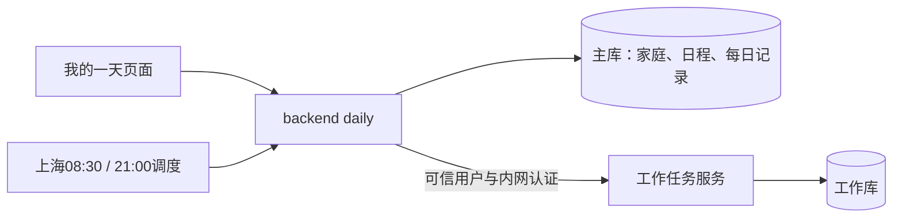
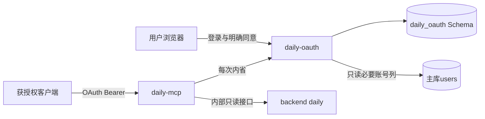

# Family-App 架构设计文档

> 版本:v2.0 · 更新日期:2026-10-12（Asia/Shanghai）
> 核对依据：当前工作树源码、Compose、OpenSpec，以及2026-10-11运行核验记录。本次未重新探测生产服务；代码存在不代表已上线。
> 配套文档:[deployment-guide.md](./deployment-guide.md)(部署细节)、[用户使用手册.md](./用户使用手册.md)(终端用户操作)

## 1. 文档目的与定位

本文档面向开发者、架构评审与运维人员,描述 Family-App 系统的总体架构、模块边界、关键流程与部署拓扑。**不重复**部署操作步骤(见 deployment-guide)与终端用户操作(见用户使用手册),仅聚焦"系统是怎么搭起来的、为什么这么搭"。

## 2. 系统概述

### 当前状态分层（阅读后续章节的前提）

| 层次 | 事实与边界 |
|---|---|
| 当前运行 | 最近核验有10个业务容器，主库Flyway V14、工作库Alembic 0002；运行镜像与工作树不同 |
| 已实现未发布 | 工作用户隔离、个人daily、独立OAuth/MCP；另有微信持续会话改造，不能把这些源码视为在线能力 |
| 独立发布目标 | 用户已确认仅抽取每日计划、必要工作隔离及只读接入，排除未上线微信会话改造；候选尚未装配完成 |
| 尚未实现 | 每日主动通知送达；08:30/21:00生成记录不等于推送提醒 |

HEAD `0ff758f`仅跟踪迁移到V12，运行JAR含V13/V14，工作树包含V15–V17。不能直接把HEAD或当前目录当作生产源码基线。详见[发布审查](./daily-release-review.md)。

### 2.1 产品定位

面向**多代同住家庭**的任务与档案管理应用,核心解决两类痛点:

- **老人友好**:大字、大按钮、高对比、emoji 图标,降低老人使用门槛
- **AI 任务拆解**:用户用一句话描述(如"下周小孙女生日派对"),AI 自动生成 N 条可执行子任务,确认后落库到任务清单

### 2.2 核心能力

| 能力域 | 说明 |
|---|---|
| 家庭与成员 | 邀请码加入家庭(6 位大写字母,排除易混字符 0/O/1/I/L);OWNER/ELDER/ADULT 角色区分 |
| 任务管理 | 5 态状态机 DRAFT/PENDING/IN_PROGRESS/COMPLETED/CANCELLED;DRAFT 24h 后自动转 CANCELLED |
| 分类管理 | 部分唯一索引 `(family_id, name) WHERE deleted_at IS NULL`,支持合并(事务原子) |
| 人员档案 | 5 类模板 BABY/ELDER/ADULT/PET/OTHER,58 字段白名单 schema 校验 |
| AI 拆解 | D-1~D-7 七端点会话 + 6 态前端状态机 + SSE 流式输出 |
| 微信入口 | 公众号验签、OAuth 绑定分流、模板消息推送(任务摘要/分配/总结) |
| 移动适配 | 768px 断点双形态布局,桌面侧边栏 + 移动底栏 4 Tab + /more 聚合 |
| 个人工作 | 独立任务服务、工作Agent和工作库；新版按可信user_id隔离，尚未发布 |
| 我的一天 | 本人工作、家庭任务及日程聚合；计划调整/确认与复盘，已实现未发布 |
| 远程只读 | 独立OAuth授权和HTTP MCP，仅计划/复盘读取，本机验收不代表真实ChatGPT接入 |

## 3. 系统总体架构

### 3.1 组件拓扑

下面的文本图仅展示家庭子系统。完整基础编排还包含工作任务服务、工作Agent和独立工作库，见§5.7与§9；远程扩展见§5.9。

```
                       ┌─────────────────────────────────────────┐
                       │              公网 / 隧道                  │
                       └─────────────────┬───────────────────────┘
                                         │
                          ┌──────────────▼───────────────┐
                          │   nginx (public-tier)        │
                          │   - /        → frontend      │
                          │   - /api/    → backend       │
                          │   - /wechat/ → wechat-service│
                          │   - /nginx-health            │
                          └──┬────────┬────────────┬─────┘
                             │        │            │
              ┌──────────────▼─┐  ┌──▼─────────┐  ┌▼──────────────────┐
              │ frontend (Vue) │  │ backend    │  │ wechat-service    │
              │  (public-tier) │  │ Spring Boot│  │ FastAPI (双网段)  │
              └────────────────┘  │ (双网段)   │  └──────────┬─────────┘
                                  └─┬───┬──────┘             │
                                    │   │       ┌────────────▼─────────┐
                                    │   │       │  wechat-service      │
                                    │   │       │  访问 backend 内部API│
                                    │   │       └──────────────────────┘
              ┌─────────────────────┘   │
              │                         │
   ┌──────────▼──────────┐    ┌─────────▼────────┐
   │ postgres (infra)    │    │ agent-service    │
   │ familyapp +         │◄───│ FastAPI/asyncpg  │ (infra)
   │ agent_reader 角色   │    │ (直读 DB)        │
   └─────────────────────┘    └──────┬───────────┘
                                     │
                              ┌──────▼──────────┐
                              │ tool-service    │
                              │ FastAPI 天气    │ (infra)
                              └─────────────────┘
```

### 3.2 双网段网络隔离

- **public-tier**：nginx、frontend、backend、wechat-service、tp-task-service、tp-agent-service。
- **infra-tier**：postgres、backend、tool-service、agent-service、wechat-service、tp-task-db、tp-task-service。
- 上述为当前基础Compose声明；两个网络均为bridge，infra-tier未配置`internal: true`，不能将网络名当作外网阻断或业务授权保证。
- **安全基线**:postgres、agent-service、tool-service **不映射 host 端口**,外部只能经 nginx → backend → 内部服务访问

### 3.3 设计原则

1. **统一入口收敛**:对外只有 nginx 80 端口,backend/postgres 等不再直接暴露
2. **入口与鉴权分工**：nginx转发业务API、微信回调与工作接口；后端和工作服务各自执行认证及作用域检查，不能仅依赖网关。
3. **降级不阻塞**:DeepSeek API Key / 天气 API Key / 微信凭证留空时,服务可启动但相应功能静默降级(`/healthz` 仍绿)
4. **老人优先**:UI 决策与文案以老人可读为第一优先级,详见 `docs/用户使用手册.md`

## 4. 技术栈

| 层 | 技术 | 版本 |
|---|---|---|
| 前端 | Vue 3 / Vite / Pinia / Vue Router / Element Plus / Axios | 3.4.38 / 5.4.2 / 4.0.3 / 4.6.4 / 2.7.8 / 1.7.5 |
| 后端 | Java / Spring Boot / Spring Data JPA / Flyway / PostgreSQL | 17 / 3.2.8 / — / 10.15.0 / 16-alpine |
| AI 服务 | Python / FastAPI / httpx / asyncpg / openai / Jinja2 / sse-starlette | (见 agent-service/pyproject.toml) |
| 工具服务 | Python / FastAPI / httpx / pydantic-settings / uvicorn | (见 tool-service/pyproject.toml) |
| 微信服务 | Python / FastAPI / httpx / pydantic / pydantic-settings / uvicorn | (见 wechat-service/pyproject.toml) |
| 反向代理 | nginx | 1.27-alpine |
| 部署 | Docker Compose(v2) | — |

新增工作服务采用Python/FastAPI、SQLAlchemy/Alembic及MCP，见[工作服务](../task-planner/task-service/pyproject.toml)。独立授权应用使用Java17、Boot3.5.12依赖平台、Spring Authorization Server1.5.8，见[授权构建](../integrations/daily-oauth/build.gradle)；HTTP MCP固定SDK1.30.0，见[依赖](../integrations/daily-mcp/requirements.txt)。主后端仍为Boot3.2.8，不因独立授权应用升级。其他精确补丁版本以构建与锁文件为准。基础编排没有Redis服务。

## 5. 模块详细设计

### 5.1 backend(Java / Spring Boot)

**入口**:`backend/src/main/java/com/familyapp` · 构建文件 [build.gradle](../backend/build.gradle)

**包结构**(按业务域划分,非严格分层):

| 包 | 职责 | 关键类 |
|---|---|---|
| `auth` | X-Access-Token认证、随机不透明token生成与校验、密码恢复 | `AuthInterceptor`、`AuthService`、`UserContext` |
| `family` | 家庭与成员、邀请码、角色 | `FamilyController`、`InviteService` |
| `task` | 任务 CRUD、5 态状态机、DRAFT 自动过期 | `TaskController`、`TaskServiceImpl` |
| `category` | 分类管理、合并(原子事务)、部分唯一索引 | `CategoryController` |
| `profile` | 人员档案 5 类模板、58 字段 schema 校验 | `PersonProfileController`、`ProfileDataSchema` |
| `profile.suggestion` | S-1 三 Tab 建议接口 | `PersonProfileSuggestionController` |
| `agent` | AgentProxyController(C-25~C-34) + DecomposeSessionController(D-1~D-7) | 见下文 |
| `wechat` | 微信账号绑定、通知、既有任务入口；conversation新模块未发布 | 包内控制器与服务 |
| `calendar` | 家庭日程、重复规则和提醒 | 包内控制器与服务 |
| `daily` | 个人计划、复盘、设置、定时生成及内部只读入口（未发布） | `DailySources`及包内服务 |
| `config` | Web配置、异步配置、拦截器注册 | 以当前包内源码为准 |
| `common` | Result/ResultCode(中文消息)、异常体系、枚举 | `ResultCode`(50310/11/12/13) |
| `user` | 用户注册/登录、access_token 入库 | `UserController` |

**认证机制**([auth/AuthInterceptor.java](../backend/src/main/java/com/familyapp/auth/AuthInterceptor.java)):

1. 读取请求头 `X-Access-Token`,要求 64 位 hex
2. 查询`users.access_token`，检查账号未删除及token更新时间（当前源码TTL为7天）；token由SecureRandom生成32字节并编码成hex，不是JWT
3. 通过 `UserContext.setCurrent()` 注入当前用户到 ThreadLocal
4. 公开登录/注册/微信绑定/密码找回路径按精确白名单处理；内部接口与配置端点还受拦截器注册规则约束，不把所有`/api/auth/**`笼统列为公开
5. **多家庭上下文**:`FamilyContextInterceptor` 读取 `X-Family-Id`,任务/分类/档案端点必带

**Agent 代理层**([agent/AgentProxyController.java](../backend/src/main/java/com/familyapp/agent/AgentProxyController.java)):

- 路径前缀:`/api/agent/v1/**`
- 守卫:每个 C-25~C-34 端点入口调用 `guardAiEnabled()`,关闭时返回 `Result.error(50310, "AI拆解功能已关闭,请联系家庭管理员")`
- 转发:`buildForwardHeaders()` 透传所有 `x-` 前缀头与 `Content-Type`
- **C-31 SSE 端点**:使用 `StreamingResponseBody` + `StreamUtils.copy` 不缓冲直通

**AI 拆解会话**([agent/DecomposeSessionController.java](../backend/src/main/java/com/familyapp/agent/DecomposeSessionController.java)):

| 端点 | 编号 | 说明 |
|---|---|---|
| `POST /api/agent/v1/decompose/sessions` | D-1 | 创建草稿会话,默认标题 PROFILE_INTERVIEW/TASK_CREATE |
| `POST /api/agent/v1/decompose/sessions/{id}/confirm` | D-5 | 确认生成 N 条任务,终态原子事务 |
| `POST /api/agent/v1/decompose/sessions/{id}/save-profile-only` | D-6 | 只存档案,状态→archived |
| `DELETE /api/agent/v1/decompose/sessions/{id}` | D-7 | 取消会话,状态→cancelled |

> 前端已有真实SSE调用`POST /api/agent/v1/decompose/start`，也保留演示分支。不能将整个链路归为Mock，也不能据代码存在声称所有真实模型场景已验收。

**功能开关**([application.yml](../backend/src/main/resources/application.yml)):

```yaml
familyapp:
  ai-decompose:
    enabled: ${AI_DECOMPOSE_ENABLED:true}   # AI 拆解总开关
```

**配置 Profile**:

- `application.yml`:默认 + 开发
- Docker部署配置由Compose环境变量及可选production覆盖层提供；当前主资源目录不存在`application-prod.yml`
- `application-test.yml`:H2 内存 + `DevTestBootstrapSeedRunner` 种子数据(避免 H2 IDENTITY 序列冲突,种子后 `ALTER COLUMN id RESTART WITH 100`)

### 5.2 frontend(Vue 3 + Vite)

**入口**:`frontend/src/main.js` · 构建 [package.json](../frontend/package.json)

**目录结构**:

| 目录 | 职责 |
|---|---|
| `src/router/` | 路由定义 + `router.beforeEach` 认证守卫 |
| `src/stores/` | Pinia:auth、tasks、categories、profiles、family、decomposeSse |
| `src/api/` | axios `client.js` + 业务 API 模块(tasks、profiles、decomposeSession、suggestions、wechat) |
| `src/views/` | 路由级视图:TaskView、PersonProfileView、DecomposeChatPageWrapper、MoreMenuView 等 |
| `src/layouts/` | AppLayout 桌面/移动双形态 |
| `src/components/` | 可复用组件:DecomposeChatPanel、EmojiAvatar、BottomTabBar、TaskCardMobile 等 |
| `src/composables/` | useIsMobile 等 |
| `src/utils/` | profileRender、taskStatus(SSOT DFA)等 |

**路由表关键项**([router/index.js](../frontend/src/router/index.js)):

```
/login                 登录(无守卫)
/dashboard             首页
/tasks                 任务管理(流程 A:TaskView 内嵌 AI 拆解)
/chat                  AI 拆解独立入口(流程 B:Wrapper + Banner 提示)
/profiles              人员档案
/templates             模板
/more                  移动端聚合低频入口(桌面端不显示)
```

**认证守卫**(同上):

1. `router.beforeEach` 检查 auth store 是否已登录
2. 未登录且目标非 `/login` → 重定向 `/login?redirect=...`

**Axios 拦截器**([api/client.js](../frontend/src/api/client.js)):

- 请求拦截:自动注入 `X-Access-Token`(从 store) + `X-Family-Id`(从 store)
- 需要家庭范围的请求在未选家庭时拒绝并提示；认证、家庭列表及`/daily/`等个人入口不一概要求家庭头
- 响应拦截:50310/11/12/13 等错误码弹中文 ElMessage

**AI 拆解 6 态状态机**([stores/decomposeSse.js](../frontend/src/stores/decomposeSse.js)):

```
idle ──sendUserMessage──▶ chatting ──generateDecompose──▶ proposing
proposing ──confirmProposal──▶ confirmed  (D-5)
proposing ──saveProfileOnly──▶ archived   (D-6)
*        ──cancelSession──▶ cancelled      (D-7)
confirmed/archived/cancelled ──reset──▶ idle
```

- 当前store包含真实SSE流函数及演示分支，具体入口以`decomposeSse.js`为准；演示结果不算真实模型验收
- 一键演示按钮触发 3 轮 `setTimeout` 剧本推进,便于无 LLM 环境下演示

**移动端适配**(Change 9 交付):

- 断点:`matchMedia('(max-width: 768px)')`,通过 [composables/useIsMobile.js](../frontend/src/composables/useIsMobile.js) 暴露响应式 `isMobile`
- 桌面:`AppLayout` 显示 `el-aside` 侧边栏
- 移动:隐藏侧边栏,显示 `BottomTabBar`(fixed 底部 4 Tab + env(safe-area-inset-bottom));低频入口聚合到 `/more`
- TaskView 移动卡片化:`v-if="isMobile"` 切换 `TaskCardMobile` 组件,共用 `utils/taskStatus.js` DFA

**验证**：测试数量随变更演进，查对应执行报告与交接；构建成功不等于lint、权限测试或实际页面验收通过。

### 5.3 agent-service(Python / FastAPI)

**入口**:`agent-service/app/main.py` · 构建 [pyproject.toml](../agent-service/pyproject.toml)

**职责**:AI 任务拆解核心服务,封装 DeepSeek LLM 调用、Prompt 模板、SSE 推流。

**关键端点**:

| 路径 | 说明 |
|---|---|
| `GET /healthz` | 健康检查,DeepSeek Key 留空时仍绿(降级) |
| `POST /api/v1/chat/stream` | SSE 流式聊天(`text/event-stream`),调用 `Decomposer.stream()` |
| `POST /api/internal/ai-decompose` | 内部接口,backend 通过 `X-Internal-Secret` 调用 |

**内部通信鉴权**([connectors/backend_client.py](../agent-service/app/connectors/backend_client.py)):

- 出站调用 backend 时带 `X-Internal-Secret`
- 入站 `/api/internal/**` 校验 `X-Internal-Secret`

**SSE 推流**([harness/sse_stream.py](../agent-service/app/harness/sse_stream.py)):

- 格式化 SSE 帧 + 定时 flush reasoning token
- 支持"减动效"模式(老人友好,可选)

**数据库直读**(Change 1 引入):

- 使用只读角色 `agent_reader`,连接串 `DB_AGENT_READER_URL`
- **注意**:bare `postgresql://` scheme 必须在 `DbReader` 初始化时规范化为 `postgresql+asyncpg://`(create_async_engine 要求 async 驱动)
- 仅用于只读查询,写操作一律经 backend

**降级策略**:

- `DEEPSEEK_API_KEY` 留空 → 返回 56001 错误码,提示"建议手动创建",不阻塞 `/healthz`
- `AI_DECOMPOSE_ENABLED=false` → 拆解请求直接返回降级错误

**验证**：以对应版本pytest报告为准，不把历史测试数量视为当前基线。

### 5.4 tool-service(Python / FastAPI)

**入口**:`tool-service/app/main.py` · 构建 [pyproject.toml](../tool-service/pyproject.toml)

**职责**:外部工具能力封装,当前仅天气查询。

**端点**([routes/weather_routes.py](../tool-service/app/routes/weather_routes.py)):

- `GET /api/weather?city=...&date=...` → 委托 `weather_service.fetch()`

**实现**([services/weather_service.py](../tool-service/app/services/weather_service.py)):

- 进程内缓存(TTL `WEATHER_CACHE_TTL=21600` 秒 = 6h)
- 缓存未命中 → httpx 调用第三方天气 API(`WEATHER_API_KEY` 留空时返回 `weather_type=unknown`,不阻塞 `/healthz`)

**部署基线**:仅 infra-tier,**不映射 host 端口**,外部必须经 backend 调用。

### 5.5 wechat-service(Python / FastAPI)

**入口**:`wechat-service/app/main.py` · 构建 [pyproject.toml](../wechat-service/pyproject.toml)

**职责**:微信公众号接入,无 DB、无 SDK,绑定数据在 backend。

**关键端点**:

| 路径 | 方法 | 说明 |
|---|---|---|
| `/wechat/callback` | GET | 微信验签,返回 echostr |
| `/wechat/callback` | POST | 消息推送回调,处理后回空串 |
| `/wechat/oauth/redirect` | GET | OAuth 分流:已绑定→H5 token fragment,未绑定→ticket 绑定页 |
| `/api/internal/menu` | POST | 内部接口,`X-Internal-Secret` 校验后创建公众号菜单 |
| `/api/internal/template/batch` | POST | 批量模板消息,单条失败隔离,不返回 5xx |
| `/healthz` | GET | 健康检查 |

**鉴权**:

- 公网回调路径用 `WECHAT_TOKEN` 验签(微信标准 SHA1 签名)
- 内部路径用 `X-Internal-Secret`(与 backend 双向校验)

**关键设计**:

- **绑定持久化**：`openid ↔ user_id`映射在主库`wechat_bind`表，不能与OAuth授权服务的token混为一谈
- **凭证留空降级**:`WECHAT_APP_ID` 等留空时仅 `/healthz` 可用,不阻塞启动

### 5.6 nginx 反向代理

**镜像**:`nginx:1.27-alpine` · 配置 [nginx/default.conf](../nginx/default.conf)

**upstream**:

```nginx
upstream backend       { server backend:8080; }
upstream frontend      { server frontend:80; }
upstream wechat_service { server wechat-service:8900; }
```

**location 规则**:

| 路径 | 转发 | 特殊配置 |
|---|---|---|
| `/` | frontend | SPA 兜底 `try_files` |
| `/api/` | backend | 默认 |
| `/api/agent/v1/chat/stream` | backend | **`proxy_buffering off`** + 长超时(SSE 必须) |
| `/wechat/` | wechat-service | 公网入口 |
| `/nginx-health` | nginx 本地 | wget 200 |

**安全基线**:对外只暴露 80(可经 `NGINX_PORT` 环境变量改),backend/postgres 等内部端口不映射 host。

### 5.7 工作任务子系统

`task-planner/task-service`提供工作REST/MCP，访问独立工作库；`task-planner/agent-service`负责工作AI编排和总结，经MCP调用任务服务。当前新源码向主后端校验应用令牌，内部调用还需机器密钥、用户范围及有效账号，拒绝仅凭用户头访问。

用户作用域覆盖任务、分类、子待办、便签、模板、版本和总结日志；关联引用须同属一人。22:00工作总结与daily的21:00个人复盘是不同作业。旧default数据不自动认领，多用户写入后不能回退到共享身份应用。

依据：[工作认证](../task-planner/task-service/src/work_auth.py)、[归属守卫](../task-planner/task-service/src/ownership.py)。这些隔离加固尚未发布。

### 5.8 每日计划与复盘（已实现未发布）



- 服务`DAILY_ENABLED`默认关闭，自动生成还需要本人主动启用。计划可调整排序、重点、保存确认，复盘可记录反馈；不自动修改原任务状态或截止日期。
- 本人家庭任务沿用TaskAssignees及实时成员验证，日程依据当日规则，工作响应逐条校验本人user_id。来源失败明确报错，不保存为完整空计划。
- 用户/日期/类型唯一防重复，版本控制并发；保留初始快照，复盘引用计划版本及实际截止时刻。
- 历史读取重新过滤失权和删除来源。晚生成计划不冒充晨间基线，不据当前完成状态推断今日完成；停机只补当日到期记录。
- 持久化记录不等于通知送达。详见[每日运行说明](./personal-daily-planning-runbook.md)。

### 5.9 OAuth与远程只读MCP（已实现未发布）



授权采用成熟框架、PKCE S256、固定issuer/resource、精确HTTPS回调、短期不透明access token、轮换refresh token及个人撤销。邮箱密码仅用于校验，不通过旧登录接口签发应用token。授权应用单实例运行，不能直接扩容。

MCP逐请求核验active、issuer、audience、scope、expiry、client及数字用户主体，不缓存撤销；内部后端再次检查账号与实时权限。只提供`read_daily_plan`和`read_daily_review`，没有任务写入工具。输出排除内部ID、初始快照、描述和自由文本反馈，标题属于不可信数据。

`DAILY_REMOTE_ENABLED`与`DAILY_OAUTH_ENABLED`需显式开启，配置缺失拒绝启动；可选覆盖层不在基础部署中自动加载。准备的公网路径为`/mcp/daily`、资源元数据及`/daily-oauth`，公网拒绝内部业务接口和OAuth内省路径。机器密钥不交给客户端。

Cloudflare域名与HTTPS由用户确认，真实ChatGPT连接尚未验收。依据：[远程MCP](../integrations/daily-mcp/remote_mcp.py)、[OAuth运行说明](./daily-oauth-runbook.md)、[可选编排](../docker-compose.daily-oauth.yml)。

## 6. 数据模型与持久化

### 多数据域补充

- 主库保存账号、家庭、任务、档案、日程、微信及当前daily实现，使用Flyway。
- 工作库独立部署，使用Alembic；新版0003对工作关联表补user_id，调整复合唯一约束。旧default行保持隔离，不自动认领。
- 当前工作树V17新增daily_settings、daily_records，以用户/日期/类型唯一及version控制冲突。
- OAuth使用主库内独立daily_oauth Schema和独立Flyway history；最小权限角色仅可读public.users必要认证列，并管理自身授权表。
- 当前运行库最近核验为V14/0002。排除微信V15/V16而直接升到17会影响未来较低编号迁移；独立每日history或协调编号方案待设计，不允许修改已应用记录、开启乱序或repair掩盖差异。

### 6.1 数据库

- 引擎:PostgreSQL 16-alpine(`postgres:16-alpine`)
- 库名:`familyapp`(默认)
- 用户:`familyapp_user`(主读写)、`agent_reader`(只读,Change 1)
- 迁移工具:Flyway 10.15.0,脚本位于 [backend/src/main/resources/db/migration](../backend/src/main/resources/db/migration)

### 6.2 主要表(按 Flyway 迁移演进)

| 表 | 关键字段 | 索引/约束 |
|---|---|---|
| `users` | id、phone、password_hash、access_token(64 hex)、role | access_token 唯一 |
| `families` | id、name、invite_code(6 大写字母) | invite_code 唯一 |
| `family_members` | family_id、user_id、role(OWNER/ELDER/ADULT) | (family_id, user_id) 唯一 |
| `tasks` | family_id、created_by、assignee_id、categoryId、priority、source、status、expiresAt | status 索引 |
| `categories` | family_id、name、deleted_at | 部分唯一索引 `(family_id, name) WHERE deleted_at IS NULL` |
| `person_profiles` | family_id、type(BABY/ELDER/ADULT/PET/OTHER)、data(JSONB, 58 字段白名单) | (family_id, type) |
| `agent_decompose_sessions` | id、family_id、user_id、status、session_type、title | — |
| `ai_suggestions` | profile_id、type、status(8 完成/2 模板/5 待办) | — |
| `wechat_bind` | openid、user_id等，以V10迁移为准 | openid 唯一 |

### 6.3 状态枚举(硬约束)

- **任务状态**(5 值):`DRAFT` / `PENDING` / `IN_PROGRESS` / `COMPLETED` / `CANCELLED`(已替换 TODO/DONE)
- **DRAFT 过期**:24h 未确认 → 自动转 `CANCELLED`(定时任务)
- **人员档案类型**:`BABY` / `ELDER` / `ADULT` / `PET` / `OTHER`(对应 5 套 schema 子集)

## 7. 关键业务流程

### 7.1 认证与多家庭上下文

```
前端登录 → backend /api/auth/login 签发 access_token 入库
↓
前端每次请求自动注入:
  X-Access-Token: <64 hex>
  X-Family-Id: <family_id>   (任务/分类/档案端点必带)
↓
backend AuthInterceptor:
  1. 校验 token + 未过期 → UserContext.setCurrent
  2. FamilyContextInterceptor 注入 family 上下文
  3. 异常 /api/auth/** 与 /api/agent/v1/config 豁免
```

### 7.2 AI 任务拆解(双流程)

**流程 A — TaskView 内嵌**(`/tasks` 路径):

```
用户填任务标题 → 点 🤖 AI拆解 → DecomposeChatPanel 挂载
  ↓
D-1 创建草稿会话 → SSE chatting(用户可补约束) → D-4 generate 推 proposing
  ↓
用户确认 → D-5 confirm → 状态 confirmed + ElMessage 成功
  ↓
TaskView @confirmed 监听 → refreshList() 任务 +N
```

**流程 B — /chat 裸入口**(`/chat` 路径):

```
/chat Wrapper 挂载 + Banner Alert 提示"将自动创建新任务"
  ↓
用户输入描述 → 同流程 A 后续
  ↓
确认后 Wrapper router.push('/tasks') 闭环跳回
```

**状态机闭环**:6 态在 `stores/decomposeSse.js` 中实现,所有终态(confirmed/archived/cancelled)经 `reset()` 回到 idle。

### 7.3 微信公众号入口

```
用户关注公众号 → backend 推 event 到 wechat-service
  ↓
wechat-service /wechat/callback 验签(WECHAT_TOKEN) → 处理 event
  ↓
首次访问 → /wechat/oauth/redirect 分流:
  - 已绑定 openid → 302 H5 + token fragment
  - 未绑定 → ticket 绑定页 → backend 落 wechat_bind 表
  ↓
backend 触发模板消息 → wechat-service /api/internal/template/batch
  (X-Internal-Secret 校验,单条失败隔离)
```

### 7.4 移动端适配流程

```
窗口 resize / 初次挂载
  ↓
matchMedia('(max-width: 768px)') change 事件
  ↓
Pinia/composables 更新 isMobile
  ↓
AppLayout v-if 切换:
  - isMobile=false → el-aside 侧边栏
  - isMobile=true  → BottomTabBar 4 Tab + main padding-bottom 76px
  ↓
TaskView v-if 切换:
  - isMobile=false → el-table 网格
  - isMobile=true  → TaskCardMobile 卡片
```

## 8. 安全与权限设计

### 8.1 三层鉴权

| 层 | 机制 | 适用 |
|---|---|---|
| 用户认证 | `X-Access-Token`(64 hex,入库)+ ThreadLocal UserContext | 前端 → backend |
| 家庭上下文 | `X-Family-Id` + FamilyContextInterceptor | 任务/分类/档案端点 |
| 内部服务互信 | `X-Internal-Secret`(双向校验) | backend ↔ agent-service ↔ wechat-service |

### 8.2 网络隔离

- public-tier成员见§3.2，公网路径收敛到网关；Cloudflare对外HTTPS不代表源站已配置TLS
- bridge网络不替代端口限制、机器认证、用户权限及数据库最小权限
- postgres、agent-service、tool-service **不映射 host 端口**

### 8.3 功能开关(降级不阻塞)

| 开关 | 关闭时行为 |
|---|---|
| `AI_DECOMPOSE_ENABLED` | backend 返回 50310 + 前端按钮置灰,`/api/agent/v1/config` 返回 false(此端点不守卫) |
| `WECHAT_NOTIFY_ENABLED` | 全量静默降级,不发送模板消息 |
| `DEEPSEEK_API_KEY` 空 | agent-service 返回 56001,提示手动创建,不阻塞 `/healthz` |
| `WEATHER_API_KEY` 空 | tool-service 返回 `weather_type=unknown`,不阻塞 `/healthz` |
| `WECHAT_APP_ID` 空 | wechat-service 仅 `/healthz` 可用 |

### 8.4 数据完整性约束

- 邀请码:6 位大写字母,字符集 `ABCDEFGHJKMNPQRSTUVWXYZ`(排除 0/O/1/I/L)
- 分类名唯一:部分唯一索引 `WHERE deleted_at IS NULL`(软删后可重用)
- 分类合并:`@Transactional` 保证原子性
- 人员档案:58 字段白名单 + 类型分支 schema 校验(number 走 float 范围)
- 任务 DRAFT:24h 后定时任务扫转 CANCELLED

## 9. 部署架构

### 9.1 Docker Compose 拓扑

详见 [docker-compose.yml](../docker-compose.yml)，基础编排共 **10个服务**，OAuth可选覆盖层另增2个：

| 服务 | 镜像/构建 | 网段 | 端口映射 | 健康检查 |
|---|---|---|---|---|
| nginx | 自构建 `nginx:1.27-alpine` | public | `${NGINX_PORT:-80}:80` | `wget /nginx-health` |
| postgres | `postgres:16-alpine` | infra | 不映射 | `pg_isready` |
| backend | 自构建 `eclipse-temurin:17-jre-jammy` | public + infra | 不映射 | actuator health |
| frontend | 自构建 `node:20-alpine` → `nginx:alpine` | public | 不映射 | wget / |
| tool-service | 自构建 Python | infra | 不映射 | (内置) |
| agent-service | 自构建 Python | infra | 不映射 | `/healthz` |
| wechat-service | 自构建 Python | public + infra | 不映射 | `/healthz` |
| tp-task-db | PostgreSQL16 | infra | 不映射 | pg_isready |
| tp-task-service | 自构建Python | public + infra | 不映射 | /healthz |
| tp-agent-service | 自构建Python | public | 不映射 | /healthz |
| daily-oauth（可选、未发布） | 独立Java应用 | public + infra | 不映射 | 需授权协议验收 |
| daily-mcp（可选、未发布） | Python MCP | public | 不映射 | 需资源协议验收 |

### 9.2 健康检查链路

```
nginx health (wget /nginx-health)
  depends_on: backend healthy + frontend healthy
backend health (actuator)
  depends_on: postgres healthy
frontend health (wget /)
  depends_on: backend healthy
agent-service health (/healthz)
  depends_on: backend healthy + tool-service healthy
wechat-service health (/healthz)
  depends_on: backend healthy
```

### 9.3 部署脚本

- [scripts/dev.sh](../scripts/dev.sh):一键启动,首次运行从 `.env.example` 复制 `.env`,加载环境变量,启动 compose
- [dev.ps1](../dev.ps1):Windows PowerShell 等价封装
- `scripts/deploy.sh`会整套构建更新且只备份主库，不能直接用于本次工作双库/OAuth发布。不要从当前混合工作树整体升级。
- 工作容器入口自动执行`alembic upgrade head`，启动新版即可能迁移；部署前必须核对双库备份、兼容性和维护窗口。
- 生产不能把清库、更新匿名卷或重置迁移历史作为常规部署步骤；隔离测试命令不应直接复用于生产。

### 9.4 数据持久化

- `postgres-data` volume:PG 数据目录,`docker compose down` 默认不移除(需 `-v` 才删)
- `tp-postgres-data`保存工作库。OAuth授权持久化在主库独立Schema，登录会话与限流在进程内，目前只支持单实例。
- 容器重建前确认镜像可恢复、配置可恢复和数据库兼容，不能笼统称“随时重建”。

## 10. 环境变量参考

完整清单见 [.env.example](../.env.example),按用途分组:

| 分组 | 关键变量 |
|---|---|
| 数据库 | `POSTGRES_DB`、`POSTGRES_USER`、`POSTGRES_PASSWORD`、`AGENT_READER_PASSWORD` |
| 内部 API 密钥 | `INTERNAL_API_SECRET`(backend ↔ agent ↔ wechat 双向校验) |
| DeepSeek AI | `DEEPSEEK_API_KEY`、`DEEPSEEK_BASE_URL`、`DEEPSEEK_MODEL` |
| 微信公众号 | `WECHAT_APP_ID`、`WECHAT_APP_SECRET`、`WECHAT_TOKEN`、`WECHAT_TPL_*_ID`、`WECHAT_OAUTH_BASE`、`WECHAT_H5_BASE` |
| 天气 API | `WEATHER_API_KEY` |
| 功能开关 | `AI_DECOMPOSE_ENABLED`、`WECHAT_NOTIFY_ENABLED` |
| 服务发现 | `AGENT_SERVICE_BASE_URL`、`TOOL_SERVICE_BASE_URL`、`WECHAT_SERVICE_BASE_URL`、`*_BACKEND_URL` |
| 端口 | `NGINX_PORT` |

> **生产部署必改**:`INTERNAL_API_SECRET`、`POSTGRES_PASSWORD`、`AGENT_READER_PASSWORD`、`DEEPSEEK_API_KEY`、微信全套凭证。

## 11. 与现有文档的关系

| 文档 | 受众 | 重点 | 与本文档关系 |
|---|---|---|---|
| 本文档 | 开发/架构评审 | 系统怎么搭、为什么这么搭 | — |
| [deployment-guide.md](./deployment-guide.md) | 运维 | 怎么部署、容器怎么起、健康检查怎么查 | 本文 §9 概述,细节去部署指南 |
| [用户使用手册.md](./用户使用手册.md) | 终端用户(含老人) | 怎么登录、怎么建任务、怎么用 AI 拆解 | 本文 §2 概述定位,操作去手册 |

## 12. 演进与遗留

### 12.1 已完成 Change 摘要

- **Change 1**:agent_reader 只读角色 + DB 直读
- **Change 2**:`X-Internal-Secret` 双向校验
- **Change 3/4**:agent/tool 服务调用基座 + Compose DNS
- **Change 5/6**:前端基础视图
- **Change 8**:人员档案 + AI 拆解(D-1~D-7 + S-1 + 6 态状态机)
- **Change 9**:移动端响应式(768px 双形态)
- **Change 11**:微信公众号服务
- **Change 12**:微信模板消息推送基座

### 12.2 已知遗留(非阻塞,后续 change 承接)

| ID | 内容 | 影响 |
|---|---|---|
| 独立发布候选 | 尚未装配，基线与迁移历史待核对 | 现有混合工作树测试不替代候选回归 |
| 真实ChatGPT接入 | 本机协议验收已完成，真实授权连接未完成 | 不宣称已上线 |
| 双库恢复 | 简化夹具工具链通过，真实业务结构恢复仍待验收 | 不能只凭dump成功认定可恢复 |
| 主动通知 | 尚未实现 | 08:30/21:00生成不等于送达 |
| 老人友好量化验收 | lighthouse 量化未做 | 设计原则已落地,缺数据化验收 |

### 12.3 独立发布与恢复边界

用户2026-10-12确认独立抽取每日功能、工作隔离及只读接入，排除未上线微信持续会话改造。已有微信入口和密码恢复等上线功能应保留；不能只删除V15/V16或关闭开关，还须审查FamilyService等共享依赖。

候选需提供源文件允许清单和摘要、可重建步骤、独立迁移历史及未来微信接回路径。当前尚未完成候选装配。必须针对候选重新运行家庭/工作权限、原微信、密码恢复、前端、OAuth/MCP及实际业务结构迁移恢复测试，旧工作树绿测不自动覆盖候选。

恢复材料已保留实际运行JAR与本机镜像归档，隔离空库启动到V14且健康UP；这是应用恢复候选，不是原镜像完整复原，也不是生产双库恢复验收。最近双库演练使用简化虚构表，验证dump/restore、外键、序列和损坏归档拒绝，不能替代真实结构与数据验证。

故障时优先关闭入口、保留记录与归属；不要回退为共享身份工作服务。主库和工作库备份需协调写入窗口，分别dump成功不等于跨库一致。实际部署及真实授权连接仍须具体确认。

执行进度见[候选任务](../openspec/changes/personal-daily-remote-oauth/tasks.md)，证据与限制见[发布审查](./daily-release-review.md)，方案见[候选设计](../openspec/changes/personal-daily-remote-oauth/design.md)。

### 12.4 跨系统环境约束

- **9P 卷 + esbuild**:Windows PowerShell 跨 WSL UNC 路径运行 Vite 会失败,需在 WSL 原生 bash 执行 `npx vite` / `npx playwright test`
- **CRLF/LF 混合**:Edit 工具 LF 匹配 CRLF 文件会失败,需 CRLF 感知替换
- **Docker Desktop权限**：使用已授权的WSL集成环境排查，不将开放Docker socket权限作为常规操作。

---

**文档维护原则**：新增服务、作用域、信任边界、迁移历史或拓扑时，在同一变更中同步对应章节；标明运行实测日期、代码已实现和计划待实施，不只改版本日期。接口/字段以源码契约和迁移为准，验证必须区分模拟、跳过和未完成部分。本次v2.0为架构文档更新，不是部署记录。
